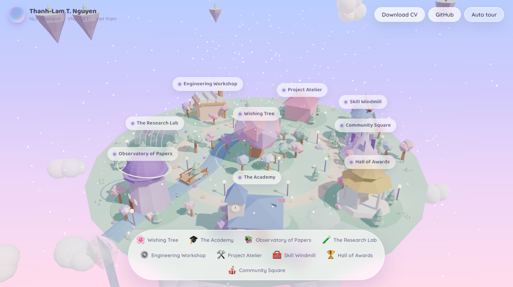

# 🏡 Lam's Dream Town — CV/Portfolio 3D

Portfolio 3D dạng "thị trấn bay bồng bềnh" với tông pastel tím – xanh – hồng.
Mỗi công trình trong thị trấn là một mục trong CV; bấm vào sẽ mở ra một **cuộn giấy kho báu** trải xuống.



Toàn bộ site là **HTML/CSS/JS tĩnh, không cần build, không cần npm** — chỉ cần đẩy lên GitHub là chạy.
Thư viện 3D: **Three.js r169** (nạp qua CDN), mọi mô hình đều sinh bằng code, không dùng file .glb/.fbx.

---

## 1. Chạy thử trên máy

Mở Terminal tại thư mục này rồi chạy:

```bash
python3 -m http.server 8777
```

Mở trình duyệt vào <http://localhost:8777>.

> ⚠️ Đừng mở thẳng `index.html` bằng cách double-click. Site dùng ES modules nên
> trình duyệt sẽ chặn nếu chạy qua `file://`. Bắt buộc phải qua một web server (lệnh trên).

---

## 2. Đưa lên GitHub (làm thủ công)

### Bước 2.1 — Tạo repo trên GitHub

1. Vào <https://github.com/new>.
2. **Repository name**: `tlam25.github.io`
   *(Đặt đúng tên này thì web sẽ chạy ở địa chỉ đẹp `https://tlam25.github.io`.
   Nếu muốn địa chỉ dạng `https://tlam25.github.io/portfolio` thì đặt tên là `portfolio`.)*
3. Chọn **Public**.
4. **KHÔNG** tích "Add a README file", "Add .gitignore" hay "Choose a license" — repo phải trống.
5. Bấm **Create repository**.

### Bước 2.2 — Đẩy code lên

Trong Terminal, chạy lần lượt (thay `tlam25.github.io` nếu bạn đặt tên repo khác):

```bash
cd /Users/nttlam/Documents/cv_web

git init
git add .
git commit -m "Dream Town portfolio"
git branch -M main
git remote add origin https://github.com/tlam25/tlam25.github.io.git
git push -u origin main
```

> 💡 Thư mục `/Users/nttlam` của bạn đang vô tình là một git repo khác (của project eCommerce).
> Lệnh `git init` ở trên tạo repo **riêng** bên trong `cv_web`, không ảnh hưởng gì tới repo kia.
> Chỉ cần nhớ: luôn `cd` vào `cv_web` trước khi chạy lệnh git cho portfolio.

Nếu GitHub hỏi mật khẩu: dùng **Personal Access Token** thay cho mật khẩu
(<https://github.com/settings/tokens> → Generate new token (classic) → tích quyền `repo`).

### Bước 2.3 — Bật GitHub Pages

1. Vào repo vừa tạo → tab **Settings** → mục **Pages** (cột bên trái).
2. Phần **Source** chọn **Deploy from a branch**.
3. **Branch**: `main`, thư mục `/ (root)` → bấm **Save**.
4. Đợi 1–2 phút, tải lại trang Settings → Pages sẽ hiện link:
   `https://tlam25.github.io/`

Xong. Mỗi lần sửa nội dung, chỉ cần:

```bash
cd /Users/nttlam/Documents/cv_web
git add .
git commit -m "update CV"
git push
```

---

## 3. Cách khác: deploy bằng Vercel (nhanh hơn, có HTTPS + domain riêng)

1. Làm xong Bước 2.1 và 2.2 ở trên (code đã nằm trên GitHub).
2. Vào <https://vercel.com> → **Sign up with GitHub**.
3. Bấm **Add New… → Project** → chọn repo `tlam25.github.io` → **Import**.
4. Phần **Framework Preset** để nguyên **Other**; Build Command và Output Directory **để trống**.
5. Bấm **Deploy**. Khoảng 30 giây sau bạn có link dạng `https://ten-repo.vercel.app`.
6. Muốn đổi tên miền: vào Project → **Settings → Domains**.

File `vercel.json` trong repo đã cấu hình sẵn cache, bạn không phải chỉnh gì.

---

## 4. Sửa nội dung CV

**Tất cả nội dung nằm trong một file duy nhất: [`js/data.js`](js/data.js).**
Không cần đụng vào code 3D.

Mỗi địa điểm trong thị trấn là một object:

```js
{
  id: 'education',          // dùng cho link chia sẻ: trang-web.com/#education
  kind: 'academy',          // kiểu công trình (xem danh sách bên dưới)
  label: 'The Academy',     // tên hiện trên bảng nổi trong game
  emoji: '🎓',              // icon trên cuộn giấy
  icon: '🎓',               // icon dưới thanh điều hướng
  title: 'Education',       // tiêu đề cuộn giấy
  subtitle: '...',          // dòng phụ in nghiêng
  angle: 90,                // vị trí quanh đảo, tính bằng độ (0–360)
  radius: 15.5,             // khoảng cách từ tâm đảo (0 = ngay giữa)
  palette: ['#cfe0fb', '#9db9ea'],  // [màu tường, màu mái]
  body: [ ... ]             // nội dung, xem bên dưới
}
```

Các kiểu công trình (`kind`) có sẵn:
`wishtree` (cây ước nguyện), `academy` (trường + tháp đồng hồ), `observatory` (đài thiên văn),
`greenhouse` (nhà kính/lab), `workshop` (xưởng + bánh răng), `library` (xưởng dự án),
`windmill` (cối xay gió), `pavilion` (đình trao giải), `hall` (lều hội).

Các khối nội dung trong `body`:

| `type`   | Dùng để               | Các trường                               |
|----------|-----------------------|------------------------------------------|
| `quote`  | Câu trích dẫn mở đầu  | `text`                                   |
| `entry`  | Một mục CV            | `title`, `when`, `role`, `body` (mảng)   |
| `tags`   | Dãy thẻ từ khóa       | `items` (mảng)                           |
| `skills` | Nhóm kỹ năng          | `group`, `items`, `tone` (`''`/`pink`/`mint`) |

Có thể dùng HTML trong các chuỗi: `<strong>`, `<em>`, `<a class="link" href="...">`.

### Đổi file CV PDF
Thay file `assets/CV.pdf` bằng bản mới (giữ nguyên tên) là nút **Download CV** tự cập nhật.

### Đổi màu chủ đạo
Mở `styles.css`, sửa các biến ở khối `:root` (`--lavender`, `--blossom`, `--periwinkle`…).
Màu của cảnh 3D nằm ở object `C` đầu file `js/town.js`.

---

## 5. Cấu trúc thư mục

```
cv_web/
├── index.html        # khung trang + overlay cuộn giấy
├── styles.css        # toàn bộ giao diện pastel
├── vercel.json       # cấu hình deploy Vercel
├── .nojekyll         # để GitHub Pages không bỏ qua thư mục js/
├── assets/
│   └── CV.pdf        # file CV tải về
└── js/
    ├── data.js       # 👉 NỘI DUNG CV (sửa ở đây)
    ├── town.js       # sinh thị trấn 3D bằng code (đảo bay, sông, thác, cây, nhà)
    ├── ui.js         # hiệu ứng cuộn giấy + thanh điều hướng
    └── main.js       # camera, ánh sáng, bấm chọn, auto tour
```

Thư viện 3D (Three.js r169) được tải từ CDN jsDelivr, không cần cài đặt gì.
